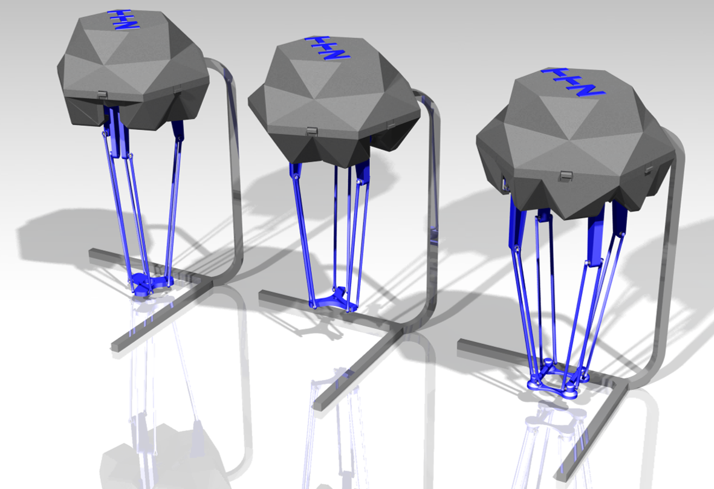

## Abstract

Für die Integration parallelkinematischer Manipulatoren in die Lehre der Hochschule Heilbronn, wurde mit dem Projekt „PARA-ENGINEER - Parallel Robot Assembly Kit for Educational Engineering and Robotics“ ein Modellbaukasten für Parallelroboter entwickelt. Mit dem Baukasten sollen Studie-rende in die Lage versetzt werden, verschiedene Themen im Bereich der Parallelkinematik, nicht nur in der Simulation, sondern auch am realen Modell zu erproben. Mit der Plattform lassen sich verschie-dene Parallelroboter mit unterschiedlicher Software und Hardware realisieren und praktisch erpro-ben.
Zum aktuellen Zeitpunkt besteht der Baukasten aus drei gängigen parallelkinematischen Manipulato-ren. Das Baukastenprinzip wurde entwickelt, um unter anderem in der Laborveranstaltung „Parallel-kinematische Systeme“ hergeleitete Vorwärts- und Rückwärtskinematik sowie die Trajektorienpla-nung zu testen. Das Ziel des Projekts bestand auch darin, dass durch wenig Einzelteile eine Vielzahl unterschiedlicher Parallelroboter realisiert werden können. Die Elektronik der Parallelroboter basiert auf einem Raspberry Pi 4 mit 8 GB Speicher. Dieser wurde mit selbstentwickelten Platinen für die Ansteuerung der Schrittmotoren und für die Sensoren erweitert.

## Additional materials

Here comes additional information about the research.
Link zu vorhandenem Repo

## Figures

